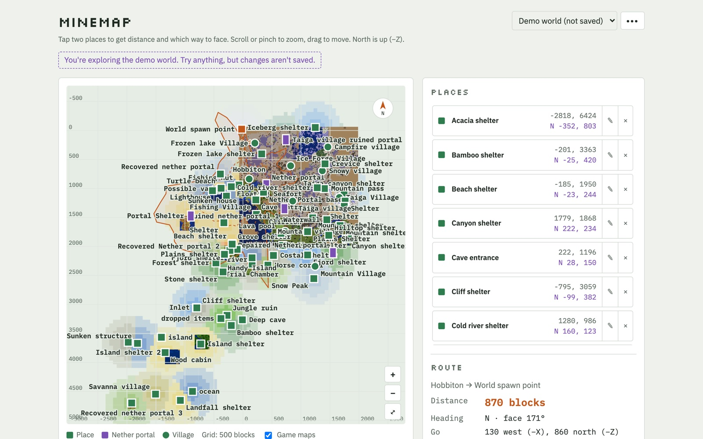

# Minemap

[](https://github.com/PeteBoucher/minemap/actions/workflows/ci.yml)
[](https://github.com/PeteBoucher/minemap/actions/workflows/e2e-preview.yml)

**Try it at [minemap.me](https://minemap.me)**: open the demo world, no sign-up needed.

A map companion for Minecraft that runs in the browser and installs as an app (a PWA). Save places, plan routes between them, and line up screenshots of your in-game maps. Built for console and mobile players who can't use map mods.



- Plan: [docs/PLAN.md](docs/PLAN.md)
- Original single-file prototype: [docs/prototype.html](docs/prototype.html)
- Payments and deployment (Stripe + Vercel): [docs/PAYMENTS.md](docs/PAYMENTS.md)

```sh
npm install
npm run dev     # local dev server
npm test        # unit tests (Vitest)
npm run build   # type-check and production build
```

Minemap is an unofficial companion app. It is not approved by or associated with Mojang or Microsoft. "Minecraft" is a trademark of Mojang Synergies AB.

## Licence

[MIT](LICENSE)
